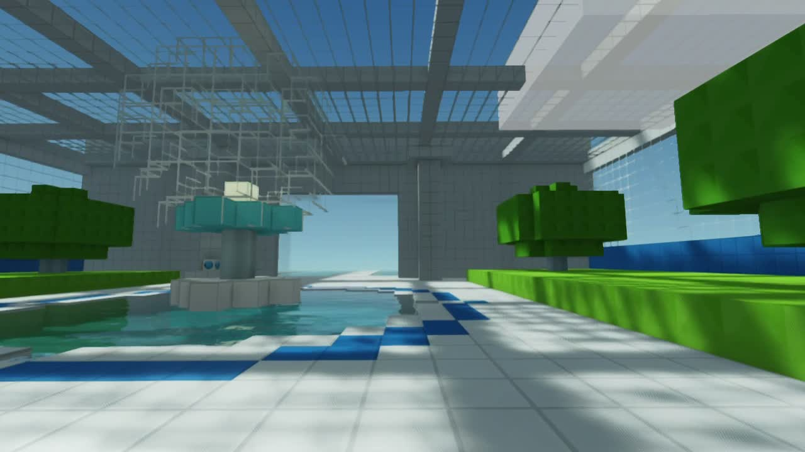

# Frutiger Aero



A singleplayer Minecraft Java 1.21.1 Fabric mod with quiet glass-and-water spaces, physical flow puzzles, botanical finds, and a garden you can keep building.

[Download version 2.0.1](https://github.com/dicnunz/frutiger-aero/releases/latest). Import the `.mrpack` into Modrinth App or Prism Launcher, launch with your Minecraft account, and enter `/aero`. The pack downloads Fabric API, Iris, and Sodium from their official URLs and includes the adapted shader. A jar and manual-install bundle are also available.

[Watch the gameplay trailer](https://github.com/dicnunz/frutiger-aero/releases/download/v2.0.1/Frutiger-Aero-improved.mp4).

Version 2.0 replaces the original fixed tour with repeatable nine-room expeditions. Choose Poolways for open water crossings, Canopy for raised gardens and stairs, or Gallery for lower rooms and larger circuits. Layouts and pipe arrangements change between journeys. Restore three flows to finish; gathering specimens is optional. Bring actual blocks and cuttings home, spend earned material credits at the workshop, and expand the permanent garden.

Run `/aero` to enter the separate `aero:retreat` dimension. Right-click the compass console to choose a journey. Right-click pipe plates to rotate them clockwise, connecting the blue source on the west side to the outlet on the east side. Lit pipes show the connected flow.

| Control | Action |
| --- | --- |
| WASD, mouse, Space | Move, look, jump |
| Right-click | Rotate a pipe, gather a specimen, use a console |
| M | Room map during a journey; field guide at home |
| G or Return Stone | Return home, keeping the unfinished journey and gathered finds |
| `/aero leave` | Return to the previous dimension, location, and game mode |

At home, continue or leave an unfinished journey before choosing another. New journeys replace the expedition rooms. The garden, discoveries, inventory, and material credits persist in the world save. Garden building uses ordinary Minecraft placement and mining.

[Install and build instructions](docs/INSTALL.md) cover Fabric, the optional adapted MakeUp shader, and source setup. A JDK 21 and Python 3 are needed for the development launcher:

```sh
python3 tools/setup-runtime.py
sh tools/gradle.sh build
sh tools/gradle.sh runClient
```

The setup downloads the two renderer jars from verified official URLs, checks their locked SHA-512 hashes, and extracts Iris's bundled Java libraries. Minecraft is downloaded by Fabric Loom for local development; it is not included in this project.

Native checks cover all three route types, flow rewards, optional finds, map access, workshop purchases, placement, mining drops, expansion, dimension return, and a full save/close/rejoin. See [validation](docs/VALIDATION.md). The available content consists of three route types, twelve specimen types, and a finite room vocabulary; procedural recombination and player construction provide repeatability. Multiplayer and combinations with other content mods remain unvalidated.

The mod, textures, sound synthesis, and integration were assembled by GPT-6.1 Sol Max for Nic. Original work uses [MIT](LICENSE). The adapted shader retains MakeUp Ultra Fast's LGPL-3.0 source and credits. Trailer music, when used, is [Dream Culture by Kevin MacLeod under CC BY 4.0](media/music/CREDITS.md). See [credits and third-party licenses](docs/CREDITS.md) and the [design research](docs/research/experience.md).
